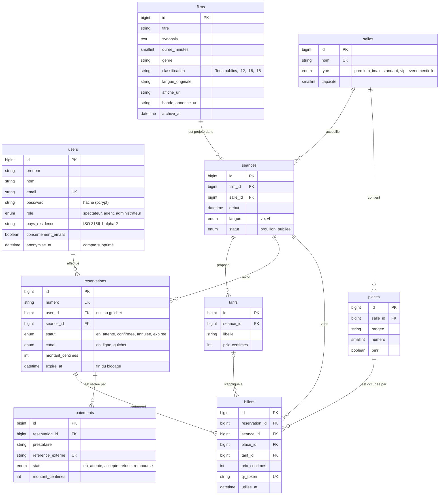

# Modèle de données

Base relationnelle MySQL 8, créée par les migrations Laravel du dossier `database/migrations`.
Le script SQL correspondant est dans `docs/schema.sql`.

## Schéma

## Choix de conception

- Une place est un siège physique d'une salle (rangée et numéro). Un billet relie une place à une séance pour une réservation : la contrainte d'unicité `(seance_id, place_id)` de la table `billets` garantit qu'une place n'est vendue qu'une fois par séance, même si deux demandes arrivent au même instant. La séance est répétée sur le billet pour porter cette contrainte.
- Les montants sont stockés en centimes (entiers) pour éviter les erreurs d'arrondi.
- Aucune donnée de carte bancaire n'est stockée : la table `paiements` ne garde que la référence du paiement chez le prestataire et son statut.
- Une réservation en attente bloque ses places jusqu'à `expire_at` (10 minutes) ; passé ce délai, elle est expirée et ses billets supprimés, ce qui libère les places.
- Une vente au guichet est une réservation sans compte spectateur (`user_id` null), avec le canal `guichet`, pour partager le même stock de places que le site.
- La suppression d'un compte efface les données personnelles et renseigne `anonymise_at` ; les réservations passées restent rattachées à rien d'identifiable, pour les statistiques. Le nom devient "Compte supprimé", l'adresse e-mail une adresse fictive unique en `.invalid`, le mot de passe une valeur aléatoire, et le consentement est retiré. Le pays de résidence est conservé: seul, il n'identifie personne et sert à l'indicateur O5. Un compte anonymisé n'est plus reconnu par l'authentification, même avec un jeton délivré avant la suppression.
- Un film archivé (`archive_at`) ou une séance en brouillon n'apparaissent pas sur le site public mais restent en base.
- La langue originale est une propriété du film (`langue_originale`) ; la version projetée, VO ou VF, est une propriété de la séance (`langue`), car un même film peut être projeté dans les deux versions.
- Les tarifs sont définis par séance, comme le prévoit la user story de gestion des séances.
- Les horaires des séances sont enregistrés à l'heure de Paris, le fuseau de l'application: l'heure saisie par l'administrateur est celle affichée aux spectateurs.
- Une séance dont des places sont vendues (au moins un billet) ne peut plus être modifiée ni dépubliée, et seule une séance en brouillon peut être supprimée.
- Les places restantes d'une séance ne sont pas stockées: elles se calculent à partir de la capacité de la salle moins le nombre de billets de la séance, ce qui évite un compteur à tenir à jour. La séance est annoncée « Bientôt complet » à partir de 90 % de places vendues, et « Complet » quand il n'en reste plus.
- Le taux de remplissage d'une séance (indicateur O4) ne compte que les billets des réservations confirmées, rapportés à la capacité de la salle. Le canal de la réservation (`en_ligne` ou `guichet`) sépare les deux types de vente. Les billets d'une réservation en attente de paiement bloquent la place, mais ne comptent pas encore comme vendus.
